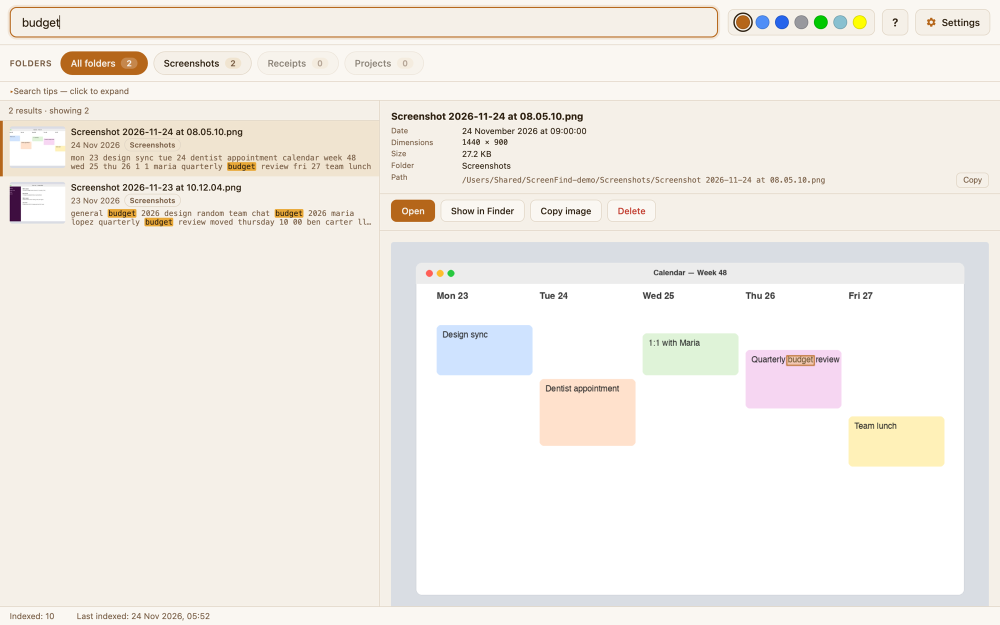
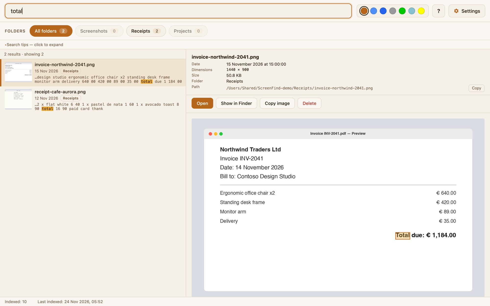
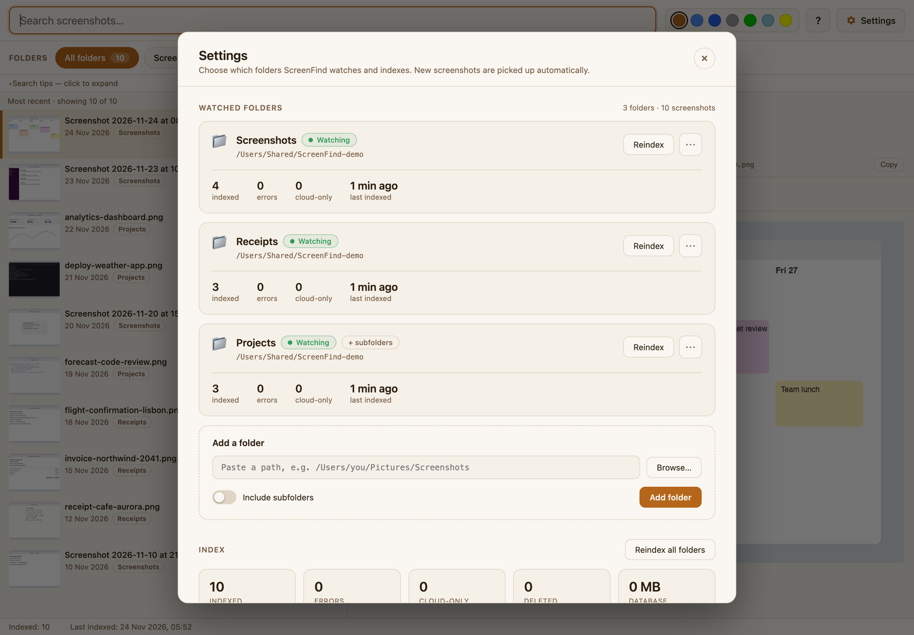

# ScreenFind

**Find any screenshot by the text inside it.** ScreenFind reads the text in your screenshots with Apple's built-in OCR and makes it instantly searchable from your browser — fully local, nothing leaves your Mac.



> [!WARNING]
> **Vibe-coded, provided as is, no responsibility taken.** ScreenFind was built largely through AI-assisted ("vibe") coding as a personal tool and is shared in case it is useful to others. It has no automated test suite, has had only a basic security review, and has been tested on a single Mac (see [Tested on](#tested-on)).
>
> It is provided **"as is", without warranty of any kind**, and without support. The author accepts **no responsibility or liability** for any damage, data loss, security issue or other consequence of using it. Use it at your own risk. See the [MIT licence](LICENSE).
>
> ScreenFind only *reads* your screenshots. The one exception is the **Delete** button in the UI, which moves a screenshot to the macOS Trash.

---

## Features

- **Search by content** — type 3+ letters and matching screenshots appear instantly, newest first. Words are highlighted in the result list *and* inside the image.
- **Several folders** — watch Desktop, Downloads, a Greenshot or OneDrive folder, with or without subfolders. Filter results by folder with one click.
- **Automatic** — new screenshots are indexed within seconds. Runs quietly in the background and starts at login.
- **Private** — Apple Vision OCR and a local SQLite index. No cloud, no accounts, no API keys.
- **Keyboard-first** — `↑ ↓` to browse, `Enter` to open, `C` to copy the image, `F` to switch folder, `?` for all shortcuts.
- **Browser address bar search** — type `ss invoice` in your address bar (one-time setup, see below).

| Filter by folder | Manage folders |
|---|---|
|  |  |

*Screenshots use made-up demo data.*

---

## Requirements

| | |
|---|---|
| **OS** | macOS only (uses Apple's Vision framework). macOS 13 Ventura or later is expected to work; only macOS 15 has been tested. |
| **Mac** | Apple Silicon recommended. Intel Macs should work but are untested. |
| **Python** | 3.11 or later. If you have [Homebrew](https://brew.sh) and no suitable Python, the installer installs `python@3.13`. |
| **Browser** | Any modern browser. Tested in Microsoft Edge and Google Chrome. |
| **Disk** | About 100 MB for Python packages, plus roughly 20 KB of index per screenshot (about 55 MB for 2,900 screenshots). |
| **Permissions** | Full Disk Access for the background service if your screenshots live in Desktop, Documents, Downloads, iCloud Drive or OneDrive (see below). |
| **OCR language** | Apple Vision's default (English). Other Latin-alphabet languages mostly work; non-Latin scripts are not configured. |

### Tested on

| | |
|---|---|
| Hardware | MacBook Pro, Apple M3 Pro |
| macOS | 15.7 Sequoia |
| Python | 3.13 (Homebrew) |
| Key packages | fastapi 0.165, uvicorn 0.54, watchdog 7.1, pyobjc 13.0, Pillow 13.0 |
| Browsers | Microsoft Edge, Google Chrome |
| Data | about 2,900 screenshots across 3 folders (local and OneDrive), indexed at roughly 2–3 per second |

If it works (or doesn't) on another setup, an issue with your macOS version and Mac model is welcome, but there is no promise of a fix.

## Install

```bash
git clone https://github.com/toffitomek/ScreenFind.git ~/code/ScreenFind
cd ~/code/ScreenFind
./install.sh
```

The installer sets up everything in `~/.screenshot-search/`, starts ScreenFind in the background (and at every login), and opens it at **http://localhost:5123**.

**One manual step — allow file access.** macOS doesn't let background programs read Desktop, Documents, Downloads or OneDrive/iCloud folders until you allow it. The installer shows Finder with the right file selected and opens the settings page:

1. In **System Settings → Privacy & Security → Full Disk Access**, **drag** the highlighted `python3.x` file onto the list and switch it on. (Don't use the `+` button; it greys that file out.)
2. In ScreenFind, open **⚙ Settings → Restart ScreenFind**.

If access is ever blocked, ScreenFind shows a warning in its status bar with a button that walks you through this again.

> Keep the cloned folder **outside** OneDrive, iCloud Drive or Dropbox. Synced folders lock files and break Python. The installer detects this and installs a copy instead.

### Update

```bash
cd ~/code/ScreenFind && git pull && ./install.sh
```

### Uninstall

```bash
./uninstall.sh          # removes the app, keeps your index and settings
./uninstall.sh --all    # also deletes the index and settings
```

Your screenshots are never touched.

---

## Use

1. Open **http://localhost:5123** (bookmark it).
2. **⚙ Settings → Add a folder**: paste a path or click **Browse…**, and optionally include subfolders. The folder is indexed in the background, roughly 2–3 screenshots per second.
3. Type in the search box.

| Search | Finds |
|---|---|
| `expense card` | the words next to each other (default) |
| `expense AND card` | both words anywhere |
| `azure OR aws` | either word |
| `azure NOT devops` | excludes a word |
| `agen` | prefixes: agent, agency… (3+ letters) |
| `jane.doe@example.com` | dots, @, slashes are handled automatically |

In **⚙ Settings**, each folder has:
- **Reindex** — a quick catch-up that reads only new or changed screenshots. You rarely need it, because new files are picked up automatically.
- **⋯ → Re-OCR every file** — re-reads every screenshot. Slower; use it after changing OCR settings.
- **⋯ → Remove folder** — removes the folder from search without deleting any files.

Hover any button for an explanation.

### Search from the browser address bar

Add a custom search engine. In Chrome or Edge: Settings → Search engine → Manage search engines → **Add**.

- Name: `ScreenFind`, Shortcut: `ss`
- URL: `http://localhost:5123/?q=%s`

Then type `ss` + space + your words in the address bar.

### Command line (optional)

```bash
alias screenfind="$HOME/.screenshot-search/venv/bin/screenshot-search"
screenfind "invoice"                 # search from the terminal
screenfind --stats                   # per-folder counts
screenfind --reindex --folder PATH   # reindex one folder (add --full to re-OCR)
```

---

## Troubleshooting

| Problem | Fix |
|---|---|
| Page doesn't load | `launchctl kickstart -k gui/$(id -u)/com.screenfind.server`, then check `~/.screenshot-search/logs/server.log` |
| "macOS is blocking folder access" | Follow the steps in the warning (Full Disk Access, then Restart) |
| New screenshots don't appear | ⚙ Settings shows each folder's status. Cloud-only OneDrive files are indexed once they download |
| Broke after `brew upgrade python` | Re-run `./install.sh`, then grant Full Disk Access again (the Python path changed) |

Full documentation, architecture and API: **[PROJECT.md](PROJECT.md)**.

---

## Privacy and security

- **Everything stays on your Mac.** OCR uses Apple's on-device Vision framework. There are no network calls, analytics, accounts or API keys.
- The index (`~/.screenshot-search/index.db`) contains the **full text of your screenshots**. Treat it as sensitive as the screenshots themselves, for example in backups.
- The web server listens on `127.0.0.1` only, so other computers can't reach it. It has no login: any program running on your Mac can query it. Requests from other websites are rejected, and so are requests made under another site's address (DNS rebinding).
- To remove everything, run `./uninstall.sh --all`, then remove the Python entry from Full Disk Access.

## Licence

[MIT](LICENSE). Free to use, copy, modify and share, provided **as is, without warranty of any kind**. This project is not affiliated with Apple or Microsoft.
